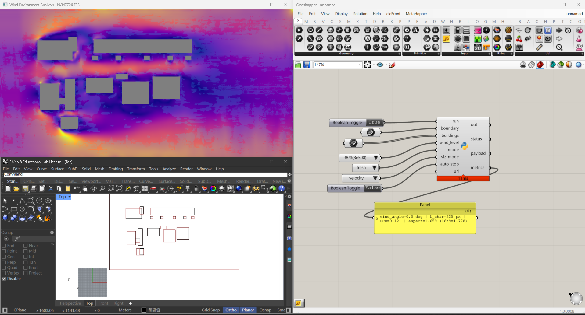
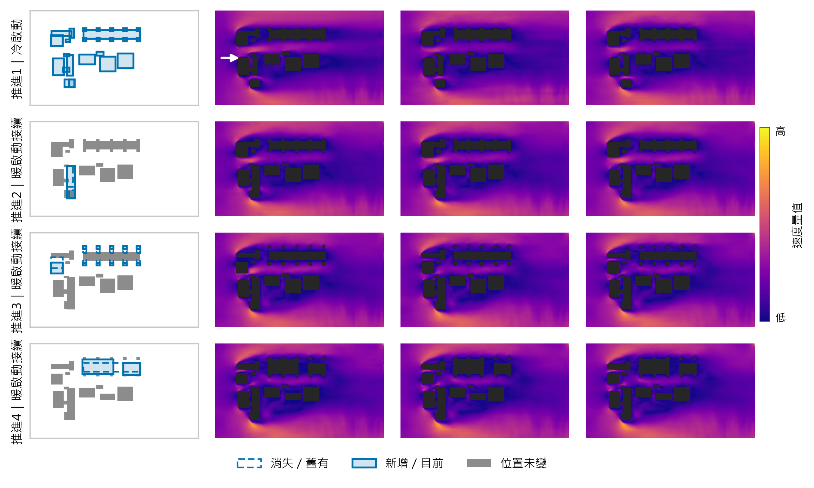
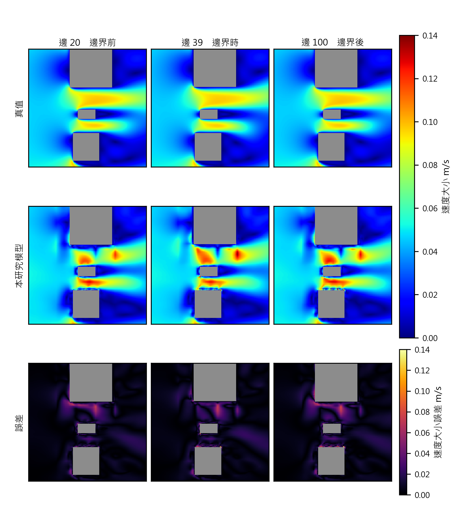
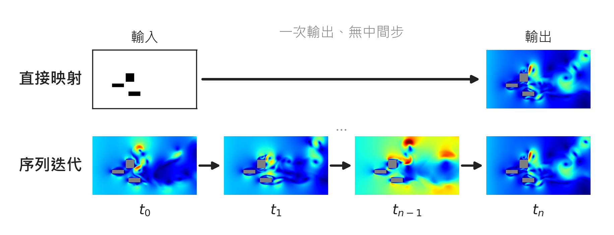
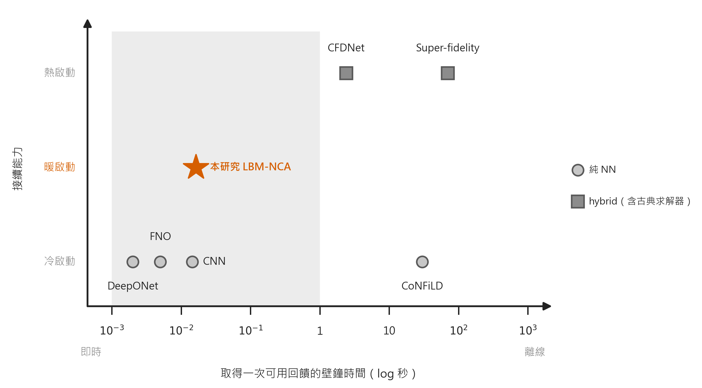

# lbm-nca-thesis

<!-- hero --><table><tr><td></td><td></td></tr><tr><td></td><td></td></tr></table>

**Neural Cellular Automata for CFD in Architectural Design**

[](LICENSE)
[](https://www.python.org/)

繁體中文說明：[README.zh-TW.md](README.zh-TW.md)

A neural cellular automaton that predicts the steady-state mean wind field
around a two-dimensional urban building layout, together with the complete
lattice-Boltzmann pipeline that generates its training data and a WebSocket
bridge that runs the trained model live inside Rhino/Grasshopper.

The surrogate is a local update rule applied repeatedly to a field, not a
one-shot image-to-image mapping. Given the converged flow of one layout it
refines that field into the converged flow of a neighbouring layout, so an
architect editing a massing model pays only for the edit rather than for a
fresh simulation.

This repository accompanies a master's thesis at National Yang Ming Chiao Tung
University. It contains the code and the trained weights; the dataset is not
distributed, because it can be regenerated from the code here (see
[docs/DATA_GENERATION.md](docs/DATA_GENERATION.md)).

<p align="center">
  
  <br>
  <em>Live inference: geometry edited in Grasshopper on the right drives a Taichi-rendered
  wind field on the left, at interactive frame rates.</em>
</p>

---

## The pipeline

```
morphospace          lbm                       nca                    bridge
──────────────       ───────────────────       ─────────────────      ──────────────
building layouts  →  D2Q9 MRT-LES solver   →   NCA surrogate      →   Rhino /
+ G_vec (14D)        HDF5 → Zarr               training + eval        Grasshopper
```

| Package | What it does |
| --- | --- |
| `lbmnca.morphospace` | Samples building layouts from a PCA design space, rasterises them to masks, and computes `G_vec`, a 14-dimensional geometric descriptor. |
| `lbmnca.lbm` | GPU lattice-Boltzmann solver (D2Q9 lattice, multiple-relaxation-time collision, Smagorinsky LES) that simulates each layout to convergence, writes HDF5 trajectories, and converts them to the Zarr training format. |
| `lbmnca.nca` | The neural cellular automaton surrogate: perception, update rule, loss terms, training loop, and evaluation metrics. |
| `lbmnca.bridge` | WebSocket server plus a Taichi GGUI renderer, so a layout drawn in Grasshopper or in the browser is solved and displayed in real time. |

### Why a cellular automaton, not a one-shot network

<p align="center">
  
</p>

Most learned CFD surrogates are a direct mapping: geometry in, converged field
out, with no state in between. This surrogate instead applies a local update
rule repeatedly to a field, the way the lattice-Boltzmann solver itself does.
Because the model already knows how to converge a field, it can be handed the
converged flow of one layout and asked to relax it into the converged flow of
a *neighbouring* layout — a warm start — instead of converging from nothing on
every edit.

<p align="center">
  
</p>

Pure feed-forward surrogates (CNN, FNO, DeepONet) are fast but always cold-start
from geometry alone. Hybrid solvers that wrap a classical solver (CFDNet,
Super-fidelity) can warm-start but pay for a solver call on every step. This
surrogate sits where the field-editing use case actually needs to be: warm-start
capable, at interactive (sub-second) latency.

## Results

<p align="center">
  
</p>

Ground truth (top), model prediction (middle), and the resulting error field
(bottom) for velocity magnitude, evaluated on layouts drawn from inside, at,
and beyond the training domain's boundary — error stays concentrated at
building edges and does not blow up outside the training envelope.

<p align="center">
  
</p>

Four successive design edits, each warm-started from the previous edit's
converged field: the surrogate only has to relax the local disturbance the
edit introduces, not resolve the whole domain again.

## Publications

- CAADRIA 2025 — Bo-Xuan Lu, June-Hao Hou, "Neural Cellular Automata for
  Dynamic Ventilation in Architectural Spaces,"
  [caadria2025_858](https://papers.cumincad.org/cgi-bin/works/paper/caadria2025_858)
- CAADRIA 2026 — Bo-Xuan Lu, June-Hao Hou, "Modular Neural Cellular Automata
  (M-NCA): A Physics-Informed Framework for Real-Time Dynamic Simulation in
  Architectural Design,"
  [caadria2026_232](https://papers.cumincad.org/cgi-bin/works/paper/caadria2026_232)
- eCAADe 2026 — Bo-Xuan Lu, June-Hao Hou, "Simulation Follows Action: A
  Dynamic Warm-Start GC-NCA Framework for Wind-Aware Architectural Design,"
  [ecaade2026_147](https://papers.cumincad.org/cgi-bin/works/paper/ecaade2026_147)

### Authors

Bo-Xuan Lu¹, June-Hao Hou²
Graduate Institute of Architecture, National Yang Ming Chiao Tung University
¹apc582nntscott@arch.nycu.edu.tw, ²jhou@arch.nycu.edu.tw

---

# Installation & usage

## Requirements

Inference and training both need an NVIDIA GPU. The solver especially so: it
runs on a 2560 × 1440 lattice and reserves 80 % of device memory by default.
This is not a workload that fits on a CPU or a free cloud tier.

| | Minimum | Used for the reported results |
| --- | --- | --- |
| GPU | CUDA-capable, 8 GB VRAM | NVIDIA RTX-class, 24 GB VRAM |
| Python | 3.10 | 3.13 |
| OS | Windows or Linux | Windows 11 |

The `bridge` package additionally needs a Vulkan-capable driver for the Taichi
GGUI window, and Rhino 7 or 8 if you want the Grasshopper component.

## Installation

```bash
git clone https://github.com/scott-lbx/lbm-nca-thesis
cd lbm-nca-thesis
python -m venv .venv
```

PyTorch has to come from its own index, because the right wheel depends on your
CUDA version. Replace `cu126` with whatever your driver supports:

```bash
# Windows
.venv\Scripts\pip install torch torchvision --index-url https://download.pytorch.org/whl/cu126
.venv\Scripts\pip install -e ".[all]"

# Linux / macOS
.venv/bin/pip install torch torchvision --index-url https://download.pytorch.org/whl/cu126
.venv/bin/pip install -e ".[all]"
```

Narrower installs are available if you only need part of the pipeline:
`.[morphospace]`, `.[solver]`, `.[train]`, `.[bridge]`.

The trained weights are stored with [Git LFS](https://git-lfs.com). If
`checkpoints/main_v4.pth` is a small text file after cloning, run `git lfs pull`.

### Where data and checkpoints live

Two environment variables control every path; nothing in the code is
machine-specific.

| Variable | Default | Contents |
| --- | --- | --- |
| `LBMNCA_DATA_ROOT` | `<repo>/data` | Generated masks, per-case configs, HDF5 trajectories, Zarr datasets |
| `LBMNCA_CHECKPOINT_ROOT` | `<repo>/checkpoints` | Model weights and normalisation statistics |

---

## Quickstart

### 1. Run the trained model

The checkpoint loader builds the network from its architecture configuration
alone, so this works without any dataset present:

```bash
python scripts/run_inference.py --checkpoint checkpoints/main_v4.pth --config configs/nca/main.yaml
```

### 2. Live inference in the browser or in Grasshopper

```bash
python -m lbmnca.bridge.main
```

The flow field is drawn in a separate Taichi GGUI window; the browser page and
the Grasshopper component are control surfaces that send geometry and receive an
acknowledgement. See [demo/README.md](demo/README.md) for the one-click
launchers and the full Grasshopper component setup.

### 3. Regenerate the dataset

Six steps, from a sampled population of layouts through simulation to the Zarr
training format. This is the expensive part and it needs a GPU for days, so the
document also gives a small verification configuration you can run in a few
hours to confirm your environment is correct before committing to the full run.
See [docs/DATA_GENERATION.md](docs/DATA_GENERATION.md).

### 4. Train

Once `LBMNCA_DATA_ROOT` holds a regenerated dataset:

```bash
python scripts/train.py --config configs/nca/main.yaml
```

---

## Repository layout

```
configs/        training configurations (canonical + ablation arms)
checkpoints/    trained weights and frozen normalisation statistics
demo/           browser page, launchers, and the Grasshopper component
docs/           architecture, data formats, regeneration, reproduction
examples/       small worked examples that need no dataset
scripts/        command-line entry points, numbered by pipeline stage
src/lbmnca/     the four packages described above
tests/          test suite; `-m "not gpu and not dataset"` runs on CPU alone
```

## Documentation

| Document | Contents |
| --- | --- |
| [docs/ARCHITECTURE.md](docs/ARCHITECTURE.md) | Conditioning vector, normalisation, and the update rule that is actually active |
| [docs/DATA_FORMAT.md](docs/DATA_FORMAT.md) | HDF5 trajectory layout and the node/edge Zarr schema |
| [docs/DATA_GENERATION.md](docs/DATA_GENERATION.md) | Regenerating the dataset, with compute cost |
| [docs/REPRODUCIBILITY.md](docs/REPRODUCIBILITY.md) | Reproducing the reported numbers |
| [docs/GVEC_SPEC.md](docs/GVEC_SPEC.md) | What each of the 14 geometric dimensions actually measures |
| [docs/DEPLOYMENT.md](docs/DEPLOYMENT.md) | Running the model inside Rhino/Grasshopper |

---

## Known limitations

These are properties of the released model, stated so that results are not
over-read.

- **Mean flow only.** The surrogate predicts the time-averaged field. A
  turbulent-fluctuation module exists in the configuration schema but has no
  released checkpoint and is out of scope.
- **Two dimensions.** The solver is D2Q9. Vertical flow structure, which
  dominates real pedestrian wind comfort, is absent.
- **The architecture name overstates what runs.** The canonical architecture is
  registered as `operator_gated_streamcollide`, but under the released
  configuration both the operator gating and the semi-Lagrangian transport are
  skipped (`transport.skip: true`). The active path is: multi-receptor
  perception, a Markov cell update with a stream-function momentum head, and
  coarse/fine multiscale accumulation. `docs/ARCHITECTURE.md` describes the path
  that actually executes.
- **The divergence-free guarantee is narrower than it sounds.** Deriving
  momentum from the curl of a stream function guarantees that each *increment*
  is divergence-free, in the fluid interior, under the same finite-difference
  stencil. It does not remove divergence already present in the initial
  condition, and it does not hold at solid boundaries.
- **The canonical arm is also an ablation arm.** `main_v4` is the A✓B✓ cell of
  the data-condition factorial, identical in configuration to `abl_use_v4`. The
  difference between the two measures training noise, not an effect.
- **The comfort overlay is uncalibrated.** The lattice-to-physical velocity
  scale is a placeholder, so the Lawson/Beaufort colouring in the live demo is
  not a physical wind-comfort assessment. The renderer says so on screen.
- **Solver limitations** in the LES model, conservation, and the Reynolds-number
  convention are documented in `docs/ARCHITECTURE.md`; they shift the ground
  truth the surrogate was trained against.

## Citing

If this code or the regeneration pipeline is useful to you, please cite the
thesis. Machine-readable metadata is in [CITATION.cff](CITATION.cff).

## License

MIT. See [LICENSE](LICENSE).
