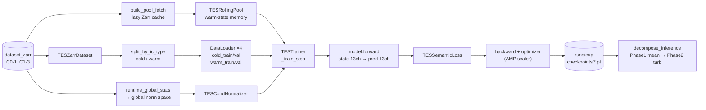
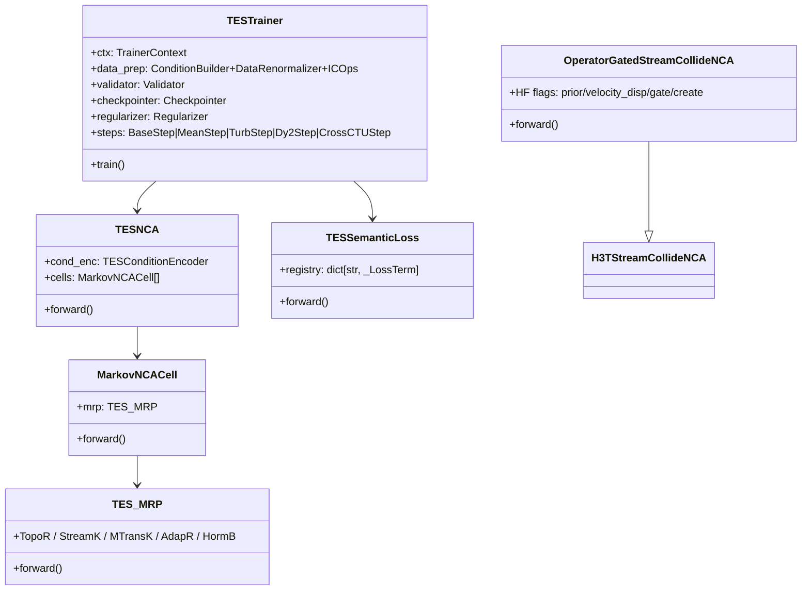

# `src/tes` 模組架構

> TES-NCA（Transient Evolution Surrogate Neural Cellular Automata）訓練層的原始碼。
> 上層說明見 `docs/ARCHITECTURE.md`；架構規格見 `../../../docs/SSOT/ARCHITECTURE_CURRENT.md`。
> 相依的 `src/utils/` 和 `src/plots/` 文件見 §3。

---

## 1. 資料流總覽

### 1-a. 磁碟資料來源

```
dataset_zarr/                        ← workspace 根目錄共用資料集
├── C0-1/   C0-1_stats.json
├── C0-2/   C0-2_stats.json
├── C0-3/   C0-3_stats.json
├── C1-1/   C1-1_stats.json
├── C1-2/   C1-2_stats.json
└── C1-3/   C1-3_stats.json
```

各 zarr 內部結構：
```
{dataset}.zarr/
└── cases/
    └── {case_key}/
        ├── snapshots   [T, 9, H, W]  float16  Mphy_lattice_norm (tes_v3 tanh)
        ├── static      [4, H, W]     float32  SDF/upstream/X/Y
        ├── g_vec       [14]          float32  幾何特徵向量
        ├── p_vec       [3]           float32  流場參數向量
        └── delta_ctus  [T]           float32  時間步間隔
```

### 1-b. Config → Dataset 接線

```
configs/*.yaml
  zarr_paths: [dataset_zarr/C0-1, ..., C1-3]   ← 多 zarr 列表
  stats_paths: [C0-1_stats.json, ...]            ← 1:1 對應（可省略，自動推導 {stem}_stats.json）
  stats_policy: dataset_global_runtime
       │
       ▼
load_tes_config()  ──→  TESTrainConfig
  train.py 驗證所有 zarr_paths 存在（FileNotFoundError if missing）
       │
       ├─ data.runtime_global_stats.build_runtime_global_stats()
       │    多 zarr stats 合併 → 全域 norm 空間
       │
       ├─ data.TESCondNormalizer（cond_17D z-score）
       │
       ├─ split_by_ic_type()
       │    ├─ cold cases → train/val DataLoader
       │    └─ warm cases → train/val DataLoader
       │
       ├─ data.TESRollingPool（warm-state persistent memory）
       │    └─ data.build_pool_fetch()（lazy Zarr cache）
       │
       └─→ build_tes_dataloader() → TESTrainer.train()
```

### 1-c. 訓練到輸出

```
TESTrainer.train()
     │
     ├─ models.build_tes_model()       ← _build_arch() 依 arch_type 分派
     ├─ loss.TESSemanticLoss           ← registry-based 多 term 路由
     └─ eval.* metrics                 ← validate_split / long_rollout gate
     │
     └─→ runs/{exp}/checkpoints/*.pt
               │
               └─ inference.decompose_inference
                  （LC decompose Phase 0 mean → Phase 1 turb 交接）
```

---

## 2. UML 圖表

### 2-a. 資料流（Data Flow）



### 2-b. 核心類別關係（Class Map）



---

## 3. 目錄結構

### 3-a. `src/tes/`（訓練主體）

```
src/tes/
├── __init__.py
├── config/                             ★設定（mean/turb 拆分 + legacy shim；見 §9）
│   ├── __init__.py                      re-export legacy + 拆分 + dispatch_train_config
│   ├── _legacy.py                       原 config.py 逐字保留（向後相容，舊 import 不破）
│   ├── base_config.py                   BaseArchConfig / DataConfig / OptimConfig（共用底層）
│   ├── mean_config.py                   MeanTrainConfig + load_mean_config
│   └── turb_config.py                   TurbTrainConfig + load_turb_config
├── train.py                            CLI 入口（legacy）+ ★build_tes_trainer（共用 build flow）
├── train_mean.py                       ★mean 薄入口（無 mode flag；見 §9）
├── train_turb.py                       ★turb 薄入口（--mean-ckpt；見 §9）
├── eval_warmzeroshot.py
│
├── data/                                資料層
│   ├── normalizer.py                    TESCondNormalizer
│   ├── tes_dataset.py                   TESZarrDataset + split_by_ic_type
│   ├── pair_mean_lookup.py
│   ├── rolling_pool.py                  TESRollingPool
│   ├── pool_fetch.py
│   └── runtime_global_stats.py
│
├── models/                              模型層（★ 重構後結構）
│   ├── factory.py                       build_tes_model() + _build_arch()
│   │
│   ├── perception/                      感知子模組
│   │   └── mrp.py                       TES_MRP（5 受體）
│   │
│   ├── conditioning/                    條件化子模組
│   │   ├── cond_encoder.py              TESConditionEncoder / GVecEncoder
│   │   ├── gvec_encoder.py
│   │   ├── mean_flow_encoder.py         MeanFlowEncoder（LC decompose spatial FiLM）
│   │   └── scale_encoder.py             ScaleConditionEncoder
│   │
│   ├── update/                          NCA 更新步
│   │   └── markov_cell.py               MarkovNCACell
│   │
│   ├── transport/                       物理 transport 算子
│   │   ├── warp.py                      SemiLagrangianWarp
│   │   └── ke_rescale.py                KErescaler
│   │
│   ├── multiscale/                      多尺度操作
│   │   └── ops.py                       downsample_state/upsample_state/make_block_mask
│   │
│   ├── assembly/                        組裝層（對外 API）
│   │   ├── flat_nca.py                  TESNCA
│   │   ├── h_base.py                    HBaseNCA
│   │   ├── h_variants.py                H0-H5 合併（HSharedScale/HLapRes/HParentLeaf/HMultirate/HBlockRefine/HPODModal）
│   │   └── transport_variants/
│   │       ├── h3t_warpresidual.py      H3TWarpResidualNCA / H3TWarpResidualSerialNCA
│   │       ├── h3t_streamcollide.py     H3TStreamCollideNCA
│   │       └── operator_gated.py        OperatorGatedStreamCollideNCA（★ 現行主架構）
│   │
│   ├── baselines/                       對照組
│   │   ├── ar_fno.py / unet_modern.py / dilated_resnet.py / unet_steady.py
│   │   ├── baseline_stepper.py
│   │   └── _cond_inject.py
│   │
│   └── [shims]                          向後相容重匯出（舊路徑 → 新模組）
│       ├── model_factory.py → factory
│       ├── condition_encoder.py → conditioning/
│       ├── mrp_cell.py → perception/
│       ├── markov_nca_cell.py → update/
│       ├── multiscale_ops.py → multiscale/
│       ├── scale_condition.py → conditioning/scale_encoder
│       ├── tes_nca.py → assembly/flat_nca
│       ├── h_base.py → assembly/h_base
│       ├── h_shared_scale_nca.py → assembly/h_variants
│       ├── h_lapres_nca.py → assembly/h_variants
│       ├── h_block_refine_nca.py → assembly/h_variants
│       ├── h_multirate_nca.py → assembly/h_variants
│       ├── h_parent_leaf_nca.py → assembly/h_variants
│       ├── h_pod_modal_nca.py → assembly/h_variants
│       ├── h3t_warpresidual_nca.py → assembly/transport_variants/h3t_warpresidual
│       ├── h3t_streamcollide_nca.py → assembly/transport_variants/h3t_streamcollide
│       └── operator_gated_streamcollide_nca.py → assembly/transport_variants/operator_gated
│
├── loss/                                損失層（★ 重構後結構）
│   ├── semantic_loss.py                 TESSemanticLoss（外部 API）
│   ├── context.py                       _LossContext dataclass（lazy properties）
│   ├── registry.py                      _build_registry() + _REGISTRY
│   │
│   ├── terms/                           Loss term 實作（依物理語義分類）
│   │   ├── obs_mphy.py                  ObsMphy_*（MAE + stab + mean_flow_loss）
│   │   ├── phys_residual.py             PhysMass_* + FNeq_*
│   │   ├── boundary.py                  BndWall_*
│   │   ├── struct_velocity.py           StructVel_*（motion/vorticity/enstrophy/KE）
│   │   ├── struct_wake.py               StructWake_* + StructVort_*
│   │   ├── perceptual.py                SSIM + spectral_power_match（fp32-safe）
│   │   ├── temporal_ke.py               domain_mean_ke / two_window_ke / jacobian_amp
│   │   ├── diagnostics.py               Diag_*（不進 LossTotal，只診斷）
│   │   ├── obs_vphy.py                  ObsVphy_*（denorm + vel/vort MAE）
│   │   ├── obs_state.py                 ObsState_*（rho/stress MAE）
│   │   ├── inflow_prior.py              HF-1d 決定性邊界
│   │   └── turb_phase.py                LC decompose P1 fluct loss
│   │
│   └── [shims]                          向後相容重匯出（舊路徑 → terms/）
│       ├── loss_terms_v2.py → terms/*（所有 v2 函式 + RHO_CH/JX_CH/JY_CH）
│       ├── loss_terms_m1a.py → terms/obs_vphy + obs_state
│       ├── inflow_prior.py → terms/inflow_prior
│       └── turb_phase_loss.py → terms/turb_phase
│
├── training/                            訓練層（★ 重構後結構）
│   ├── trainer.py                       TESTrainer（god-class，legacy；mean/turb 共用，現役）
│   ├── trainer_base.py                  ★TrainerBase（module-agnostic 主迴圈骨架；見 §9）
│   ├── mean_trainer.py                  ★MeanTrainer（委派 backing TESTrainer 之 mean 子元件）
│   ├── turb_trainer.py                  ★TurbTrainer（委派 backing 之 turb 子元件）
│   ├── trainer_context.py               TrainerContext dataclass（共用狀態容器）
│   ├── schedule.py                      curriculum 純函式（sample_k/get_dk/…）
│   ├── early_stopping.py                TESEarlyStopping
│   │
│   ├── steps/                           訓練 step 變體
│   │   ├── base_step.py                 BaseStep（standard rollout）
│   │   ├── mean_step.py                 MeanStep（Phase 0 mean_module）
│   │   ├── turb_step.py                 TurbStep（Phase 1 turb）
│   │   ├── dy2_step.py                  Dy2Step（detached self-exposure）
│   │   ├── cross_ctu_step.py            CrossCTUStep（WFC staircase）
│   │   └── pool_step.py                 PoolStep（rolling pool writeback）
│   │
│   ├── validation/
│   │   └── validator.py                 Validator（_validate_split + long_rollout gate）
│   │
│   ├── checkpoint/
│   │   ├── checkpointer.py              Checkpointer（save/load/resume）
│   │   │                                ★save_checkpoint()＝存 ckpt 單一實作
│   │   │                                （Checkpointer.save 與 TESTrainer._save_checkpoint 皆委派）
│   │   └── identity.py                  ckpt 身分區塊 build / verify（禁 config fallback）
│   │
│   ├── data_prep/                       Batch 前處理
│   │   ├── condition_builder.py         ConditionBuilder（cond 17D 組裝）
│   │   ├── data_renormalizer.py         DataRenormalizer（zarr→trainer space）
│   │   └── ic_ops.py                    ICOps（IC sampling + teacher forcing）
│   │
│   └── regularization/
│       └── regularizer.py               Regularizer（KE two-window + Jacobian）
│
├── eval/
│   ├── metrics.py
│   ├── rollout_runner.py                RolloutInputs + prepare_rollout_inputs
│   ├── long_rollout.py
│   ├── turb_long_rollout.py             舊線（operator_gated）turb 長 rollout clean-window 評估
│   ├── turb_redesign_metrics.py         ★turb 兩線共用 grain/結構 metric + clean_window gate
│   │                                    + long-rollout curves（enstrophy/hf_frac/dir_aniso/
│   │                                    grain_tv + render_turb_sequence re-export；redesign
│   │                                    eval/train 與舊線 turb_long_rollout 統一檢討標準）
│   ├── mean_gate_eval.py
│   ├── case_metrics.py
│   ├── visual_metrics.py
│   ├── vqi/                             ★VQI 視覺品質指數（項＝terms；定義與使用分開）
│   │   ├── __init__.py                   對外唯一入口 build_vqi / build_vqi_from_files
│   │   ├── terms.py                      項的實作、項組 TERM_SETS、視覺校準標籤
│   │   ├── anchors.py                    錨點建構（上錨＝真值自身噪聲）與歸一
│   │   └── score.py                      合成（取最小子分數）、否決、工廠函式
│   ├── rp_aggregate.py
│   ├── hfs_robustness_eval.py
│   ├── pod_metrics.py
│   ├── eval_plots.py
│   ├── dy2_plots.py
│   ├── random_start_eval.py
│   └── plot_tstart_compare.py
│
├── monitoring/                          ★訓練監控組裝（mean/turb 共用核心 + 各自時空繪圖；見 §9）
│   ├── mean_vis.py                       mean 監控（compose=identity + 收斂熱圖）
│   └── turb_vis.py                       turb 監控（compose=ū+u′ + 週期/頻譜時空圖）
│
├── inference/
│   └── decompose_inference.py
│
├── utils/
│   ├── evidence.py                      ★workspace `scripts/evidence_io` 的唯一橋接
│   │                                    （身分後綴 / 禁覆寫 / `_provenance`；訓練期
│   │                                    滾動 evidence 用 `write_run_evidence`）
│   └── spatial_ops.py                   ddx / ddy / laplacian / compute_wall_band
│
├── visualization/
│   └── panels.py
│
└── archive/                             ★ 舊版實作歸檔（僅歷史參考，勿 import）
    ├── loss/                            原始 loss_terms_v2.py / m1a / inflow / turb_phase
    └── models/                          原始 tes_nca / h_base / h_series / H3T
```

### 3-b. `src/utils/`（場域處理工具）

```
src/utils/
├── FieldNormalizer.py    FieldNormalizer(nn.Module)：9ch Mphy 正規化/反正規化（tes_v3 tanh）
├── FieldConverter.py     FieldConverter(nn.Module)：Mphy ↔ Vphy 轉換
├── FieldColorizer.py     FieldColorizer(nn.Module)：場域 → RGB（GPU LUT）
├── PatchUtils.py         data_to_patches() / patches_to_full()（Hann-weighted overlap）
├── physics_utils.py      get_mask() / get_statics()
└── eval_plotter.py       plot_multi_k_convergence()
```

---

## 4. 各模組職責

### Models（新結構）

| 路徑 | 主要型別 |
|------|---------|
| `models/assembly/flat_nca.py` | `TESNCA` |
| `models/assembly/h_variants.py` | `HSharedScaleNCA` / `HLapResNCA` / `HParentLeafNCA` / `HMultirateNCA` / `HBlockRefineNCA` / `HPODModalNCA` |
| `models/assembly/transport_variants/operator_gated.py` | `OperatorGatedStreamCollideNCA`（★ 現行主架構）|
| `models/assembly/transport_variants/h3t_streamcollide.py` | `H3TStreamCollideNCA` |
| `models/assembly/transport_variants/h3t_warpresidual.py` | `H3TWarpResidualNCA` / `H3TWarpResidualSerialNCA` |
| `models/perception/mrp.py` | `TES_MRP`（5 受體：TopoR/StreamK/MTransK/AdapR/HormB）|
| `models/conditioning/cond_encoder.py` | `TESConditionEncoder` / `GVecEncoder` / `MeanFlowEncoder` |
| `models/update/markov_cell.py` | `MarkovNCACell`：perceive→FiLM→project→additive update |
| `models/multiscale/ops.py` | `downsample_state` / `upsample_state` / `make_block_mask` |
| `models/factory.py` | `build_tes_model()` / `_build_arch()` |

**arch_type 選項：**

| arch_type | 類別 |
|-----------|------|
| `flat` | `TESNCA` |
| `operator_gated_streamcollide` | `OperatorGatedStreamCollideNCA`（★ 現行）|
| `h3t_streamcollide` | `H3TStreamCollideNCA` |
| `h3t_warpresidual` | `H3TWarpResidualNCA` |
| `h_shared_scale` / `h_lapres` / `h_parent_leaf` / `h_multirate` / `h_block_refine` / `h_pod_modal` | H-架構消融 |
| `baseline_*` | Baseline 對照 |

### Loss（新結構）

| 路徑 | 職責 |
|------|------|
| `loss/semantic_loss.py` | `TESSemanticLoss`：外部 API，forward + registry 路由 |
| `loss/registry.py` | `_build_registry()` + `_REGISTRY`：31 個 loss term 統一路由 |
| `loss/context.py` | `_LossContext`：lazy properties（normalizer / inflow_weight / wall_band）|
| `loss/terms/obs_mphy.py` | `obs_mphy_traj_mae` / `obs_mphy_delta_mae` / `stab_improve_loss` / `mean_flow_loss` |
| `loss/terms/phys_residual.py` | `phys_mass_divj_absmean` / `fneq_match_loss` |
| `loss/terms/struct_velocity.py` | `enstrophy_match_loss` / `ke_magnitude_match_loss` / `vel_field_decoupled_loss` |
| `loss/terms/perceptual.py` | `struct_vel_ssim_loss` / `struct_vort_ssim_loss` / `spectral_power_match_loss` / `horiz_band_fft_loss` |
| `loss/terms/temporal_ke.py` | `domain_mean_ke` / `two_window_ke_loss` / `jacobian_amp_loss` |

### Training（新結構）

| 路徑 | 職責 |
|------|------|
| `training/trainer.py` | `TESTrainer`：精簡主迴圈，組合以下子元件 |
| `training/steps/base_step.py` | 標準 rollout |
| `training/steps/dy2_step.py` | Dy2 detached self-exposure |
| `training/steps/cross_ctu_step.py` | WFC cross-CTU staircase |
| `training/steps/mean_step.py` | LC Phase 0 mean_module |
| `training/steps/turb_step.py` | LC Phase 1 turb |
| `training/validation/aggregate.py` | `aggregate_val_metrics`：val 指標跨 batch 聚合（純函式）|
| `training/checkpoint/checkpointer.py` | save / load / resume；★`save_checkpoint()` 為存 ckpt 單一實作（含落盤後 identity 斷言，缺則 raise；降級需 `TES_ALLOW_UNIDENTIFIED_CKPT=1`） |
| `training/checkpoint/identity.py` | ckpt 身分區塊（git/config sha/推論敏感超參數/denorm 常數）build + verify |
| `training/regularization/regularizer.py` | KE two-window + Jacobian reg |
| `training/data_prep/` | `ConditionBuilder` / `DataRenormalizer` / `ICOps` |
| `training/schedule.py` | curriculum 純函式（`sample_k` / `get_dk` / `get_lk` / …）|
| `training/rng_streams.py` | R7 具名 RNG 串流（`stream()` / `fresh_stream()`）＋ determinism 記錄（`apply_determinism_mode`）；★`cfg.rng_stream_isolation` 預設 False＝回傳全域 `random`，行為與舊版逐字相同。**涵蓋範圍未滿（三類不涵蓋）**：(1) `training/steps/mean_step.py` 四處裸 `random` 尚未遷移；(2) `training/` 下 10 處走 torch 全域 RNG 的抽樣（`mean_pool.py` / `turb_redesign_pool_step.py` / `dy2_step.py` / `pool_step.py`）；(3) `data/tes_dataset.py` 的 6 處 dataset 端抽樣（刻意不遷移，spawn worker 會重置模組狀態）。逐項清單見模組 docstring；isolation=True 時為部分隔離，**不可據此宣稱訓練期抽樣全部具名化** |

---

## 5. 狀態向量規格

**baseline 預設（TESModelConfig dataclass 預設值，`config.py:400-420`）：**
```
state [B, 13, H, W]
  ├─ static  [0:4]  SDF_norm, upstream_norm, X_norm, Y_norm
  └─ physics [4:13] 9ch MRT moments (Mphy_lattice_norm, tes_v3 tanh)

cond   [B, 17]  14D G_vec + 3D P_vec（TESCondNormalizer z-score 正規化後）
```

**★LC decompose mean module FINAL（v29，2026-06，config 覆寫；見 §8）：**
```
state [B, 21, H, W]
  ├─ static  [0:4]   SDF/upstream/X/Y
  ├─ physics [4:13]  9ch MRT moments
  └─ hidden  [13:21] 8ch tanh-bounded（助長 rollout 穩定，非 zero-init baseline）

cond   [B, 19]  [G_vec(14), P_vec(3), dt_log(1), ct_log(1)]  v3 完整標準
                （cond_dim 對應格式見 data_prep/condition_builder.py docstring）
```
turb module 維持 hidden=0（state_dim 13）。

---

## 6. Import 慣例

### 新路徑（推薦）

| 用途 | Import |
|------|--------|
| 建模型 | `from src.tes.models.factory import build_tes_model` |
| 現行主架構 | `from src.tes.models.assembly.transport_variants.operator_gated import OperatorGatedStreamCollideNCA` |
| 所有 loss terms | `from src.tes.loss.terms import obs_mphy_traj_mae, spectral_power_match_loss, …` |
| Loss registry | `from src.tes.loss.registry import _build_registry, _REGISTRY` |
| Training step | `from src.tes.training.steps import BaseStep, Dy2Step, MeanStep` |

### 舊路徑（shim，向後相容）

| 舊路徑 | 實際指向 |
|--------|---------|
| `models/tes_nca.py` | `assembly/flat_nca.TESNCA` |
| `models/operator_gated_streamcollide_nca.py` | `assembly/transport_variants/operator_gated` |
| `loss/loss_terms_v2.py` | `loss/terms/*`（全部 v2 函式）|
| `loss/turb_phase_loss.py` | `loss/terms/turb_phase` |

### 通用

| 用途 | Import |
|------|--------|
| 載入訓練設定 | `from src.tes.config import load_tes_config` |
| Dataset / Loader | `from src.tes.data import TESZarrDataset, build_tes_dataloader, split_by_ic_type` |
| 條件正規化 | `from src.tes.data import TESCondNormalizer` |
| 損失函數 | `from src.tes.loss import TESSemanticLoss` |
| 啟動訓練 | `from src.tes.training import TESTrainer` |
| LC decompose | `from src.tes.inference.decompose_inference import decompose_rollout` |
| **視覺品質指數** | `from src.tes.eval.vqi import build_vqi_from_files` |
| 場域正規化 | `from src.utils.FieldNormalizer import FieldNormalizer` |

#### VQI 的呼叫形態（定義與使用分開）

```python
from src.tes.eval.vqi import build_vqi_from_files

score = build_vqi_from_files(ceiling_path, ladder_path, normalizer)  # 定義，一次
r = score(pred, target, fluid_mask)                                   # 使用，每張場
r.vqi, r.binding_term, r.veto
```

錨點與否決門檻在 `build_*` 階段綁進閉包，評分器只吃**模型的直接輸出**，
反正規化、遮罩腐蝕、頻譜與歸一全在內部完成。**新增或修改量測項一律動
`eval/vqi/terms.py`**，不要寫在 `scripts/ch4_exp/e2_vqi.py`，那支只是批次 harness。

---

## 7. 設計約束（必讀）

1. **NCA state 13ch baseline**：dataclass 預設 state_dim=13 = 4 static + 9 physics，**無 hidden channels**。
   ★**但 LC decompose mean module FINAL 已 ablation 驗證採 hidden 8ch（state_dim 21，tanh-bounded 助穩定）**，
   為 mean 部署版正式設定（見 §8）。turb module 仍 hidden=0。詳 `../../../docs/SSOT/ARCHITECTURE_CURRENT.md` §4。

2. **Vphy 計算必須先反正規化**：
   `FieldNormalizer.denorm_mphy()` → `FieldConverter.toVphy()` → `Vphy_raw`。
   **不可**對 `Mphy_lattice_norm` 直接算 vel_x/y/vorticity/pressure。

3. **新增 neural head 一律 zero-initialization**（避免初期 loss 爆炸）。

4. **Loss term 新增流程**：
   - 函式實作寫入 `loss/terms/<category>.py`
   - 在 `loss/terms/__init__.py` 加 re-export
   - 在 `loss/registry.py` 的 `_build_registry()` 加 `_LossTerm` 項目
   - 未在 registry 登記的 term 名稱，`TESSemanticLoss.__init__` 立即 `ValueError`

5. **新增架構唯一入口**：實作寫入 `models/assembly/` 或其子目錄，
   並在 `models/factory.py` 的 `_build_arch()` 登記。不可在 `train.py` / `trainer.py` 直接 import 架構類別。

6. **Config 欄位驗證**：`__post_init__` 檢查不變量，違反時 `load_tes_config` 立即 `ValueError`。
   排程函式（`get_dk` 等）直接存取 cfg 欄位，缺少欄位即 `AttributeError`（刻意，確保 config 完整）。

7. **Static channel 變換**：X2 / X3 transform 在 `TESZarrDataset._apply_static_transforms`
   中執行。修改 RAM cache 前必須 `.clone()`，否則污染後續 epoch。

8. **Rollout 共用前處理**：eval 腳本一律用 `eval.rollout_runner.prepare_rollout_inputs`，
   不自行重寫 batch→pred 邏輯。

9. **LC decompose 兩階段順序**：Phase 0（mean）收斂後才啟動 Phase 1（turb）。
   交接透過 `inference/decompose_inference.py` 的 KE ratio gate 判定，不可人工跳過。

10. **FieldNormalizer stats 版本**：只讀 `tes_v3 tanh` 格式的 `global_stats.json`。
    舊版 v2 / z-score 仍支援；`from_file()` 自動判斷版本。

11. **archive/ 禁 import**：`src/tes/archive/` 僅供歷史參考，不可從任何 module 直接 import。
    向後相容需求請用同層的 shim 檔案（`loss/loss_terms_v2.py` 等）。

---

## 8. LC decompose mean module — FINAL（2026-06，v29）

> mean campaign（v20→v29）定案。完整實驗帳：`../../docs/experiments/LC_Decompose/LC_Mean_FINAL_Integration_Report.md`。
> 定案 ckpt：`runs/LC_decompose/mean_FINAL_v29_maskloss_step5000.pth`；config：`configs/lc_decompose/lcd_mean_warm_c3_v29_maskloss.yaml`。

### 8-a. 定案規格（與 §5/§7.1 baseline 的差異）

| 項目 | baseline 預設 | ★LC mean FINAL |
|------|--------------|----------------|
| state_dim | 13（無 hidden）| **21**（4+9+8 tanh-bounded hidden）|
| cond_dim | 17 | **19**（+dt_log+ct_log）|
| arch | — | `operator_gated_streamcollide` |
| **mrp.enabled** | false | **true ★決定性 lever**（多受體邊緣 perception）|
| nca_spectral_modes | 24 | **48**（高頻分支）|
| transport.skip | — | true（advection 對穩態 mean 無益，v27 證偽）|

成效（fluid-masked metric）：StructVel SSIM 0.821 / IC_Copy 0.972 / composite 0.600 / rel_l2 0.213。

### 8-b. campaign 新增/改動功能（位置對照，皆遵 §3 慣例）

| 功能 | 位置 | 說明 |
|------|------|------|
| **fluid-masked SSIM（metric）** | `eval/visual_metrics.py`：`_ssim_scalar(mask=)`、`struct_vel/vort_rgb_ssim(fluid_mask=)` | SSIM 只在 fluid 像素平均（排除 solid 邊界拖累，跨 case 公平）。`mask=None` 向後相容 |
| **fluid-masked SSIM（loss）** | `loss/terms/perceptual.py`：`_ssim_loss_2d(mask=)`、`struct_vel/vort_ssim_loss` 傳 fluid_mask（擴 K） | 與 metric 對齊，聚焦 fluid wake |
| **多 Re 比較圖** | `src/plots/train/mean_eval_sequence.py`：`plot_eval_sequence_multi` + `_shared_norms` | ≥6 跨 Re sample 共用 color norm；訓練中 `lc_vis_external` async 產 `plots/mean_eval_sequence_latest.png` |
| **收斂判定（plateau-onset）** | `src/plots/train/mean_eval_sequence.py`：`mae_ssim_converged` | 改標 SSIM 峰值 plateau-onset（非首次跨門檻；場持續改善時首次跨門檻太早）|
| **垂直翻轉 aug** | `data/tes_dataset.py`：`_apply_vflip`（與 §7.7 `_apply_static_transforms` 同層先例）+ `config.py:mean_vflip_aug_prob` | CFD 左進右出僅 y 鏡像合法；data 翻 + MRT y-odd {jy,qy,pxy} 變號；g_vec/coord/p_vec 不變。**只 train**（val=0）。物理分析：`LC_Mean_VFlip_Aug_Analysis.md` |
| **SDF mask threshold** | `lc_vis_external`/`lc_rollout_vis_test`/trainer | 用 `norm_sdf(0)`（≈0）非硬 0.5（連續 SDF 硬 0.5 → 膨脹圓 blob）|

### 8-c. ✅ 已解決 / ⚠️ 待排程

- ✅ **多 Re mean-vis rollout DRY 已收斂**（2026-06-16）：抽共用核心 **`eval/mean_rollout_vis.py::build_mean_seq_cols`**
  （roll + masked MAE/SSIM + 收斂判定 + 組 seq_cols），由 `trainer._rollout_vis_mean` + `scripts/lc_vis_external`
  + `scripts/lc_rollout_vis_test` 三方共用。SDF threshold / masked SSIM / 收斂判定改一次即三方一致。
  ★canonical = async（`lc_vis_external` 載 ckpt、`--device cpu`，不碰 live training）。caller 各保留 cond/renorm/n_steps setup，內迴圈 call core。
- ✅ getattr no-fallback 清零（2026-06-16）：mean_step.py 19 處 + schedule.py 8 處 + validator.py 1 處
  `getattr(cfg,...,default)` 全改 `cfg.key` 直存（動態欄位名改 2-arg getattr 無 default）；
  新增 `per_step_delta_ctu` config 欄位取代 validator fallback。全 src/tes（排除 archive）零 cfg-fallback。

---

## 9. mean / turb 頂層雙管分離（2026-06-16，ARCH_mean_turb_split_plan）

> 目標：入口/設定/trainer/監控**切乾淨 mean/turb**，**底層元件（models/loss terms/data/metrics）共用不變**。
> additive + shim：舊 `train.py`/`config.py`/`trainer.py` 路徑全保留（running turb 零影響）。

### 9-a. 三層分離（廢除 mode flag）

| 層 | mean | turb | 共用底層（不變） |
|----|------|------|------------------|
| **入口** | `train_mean.py` | `train_turb.py`（+`--mean-ckpt`）| — |
| **設定** | `config/mean_config.MeanTrainConfig` | `config/turb_config.TurbTrainConfig` | `config/base_config`（arch/data/optim）|
| **trainer** | `training/mean_trainer.MeanTrainer` | `training/turb_trainer.TurbTrainer` | `trainer_base.TrainerBase` |
| **監控** | `monitoring/mean_vis` | `monitoring/turb_vis` | `eval/mean_rollout_vis.build_rollout_seq_cols`（compose_fn/converged_fn hook）|
| 模型/loss/data/metrics | — | — | `models/` `loss/terms/` `data/` `eval/`（config 驅動）|

### 9-b. build flow（橋接）

`train.py::build_tes_trainer(cfg, finetune, resume, tag)` = 共用 build flow（zarr→stats→split→loaders→model→loss→TESTrainer→load ckpt）。
- `train_mean.build_mean_training(path)` = `load_mean_config`(驗證) + `load_tes_config`(legacy proven build) + `build_tes_trainer` → `MeanTrainer(backing)`。
- `MeanTrainer`/`TurbTrainer` = **委派 façade**（持有 backing `TESTrainer`，override `train_step`/`validate`/`save_monitor_vis` 委派至已驗證子元件，**不重寫 god-class**）。

### 9-c. 監控泛化（共用核心 + 不同時空繪圖）

`build_rollout_seq_cols(roll_step, ..., compose_fn=None, converged_fn=None)`：roll + masked MAE/SSIM + 收斂判定 + 組欄為兩條 pipeline 共用；mean/turb 差異收斂進 `compose_fn`（mean=identity；turb=`ū+u′`）與 `converged_fn`（mean fixed-point；turb limit-cycle）+ 各自時空繪圖（`mean_vis`/`turb_vis`）。

### 9-d. 現況（Phase 1 + 橋接已接；待完成）

- ✅ 可用：config 拆分、monitoring 泛化、雙入口可建構可訓練（委派 backing，行為同 legacy）、getattr 清零。
- ⚠️ 待 Phase 2/3：① turb `--mean-ckpt` 凍結 mean 混入（治 proposal T1 dead mean_mix，需改 turb_step）尚未接，目前用 GT mean；② TESTrainer god-class 內部 mode-flag 仍在（MeanTrainer 委派它），完整內部拆分待 turb 訓練空檔；③ 真正訓練 smoke 待 GPU 空（turb 佔用中）。
- 過渡期：mean/turb 訓練可用新入口（`python -m src.tes.train_mean/turb`）或續用 `train.py`，行為一致。
